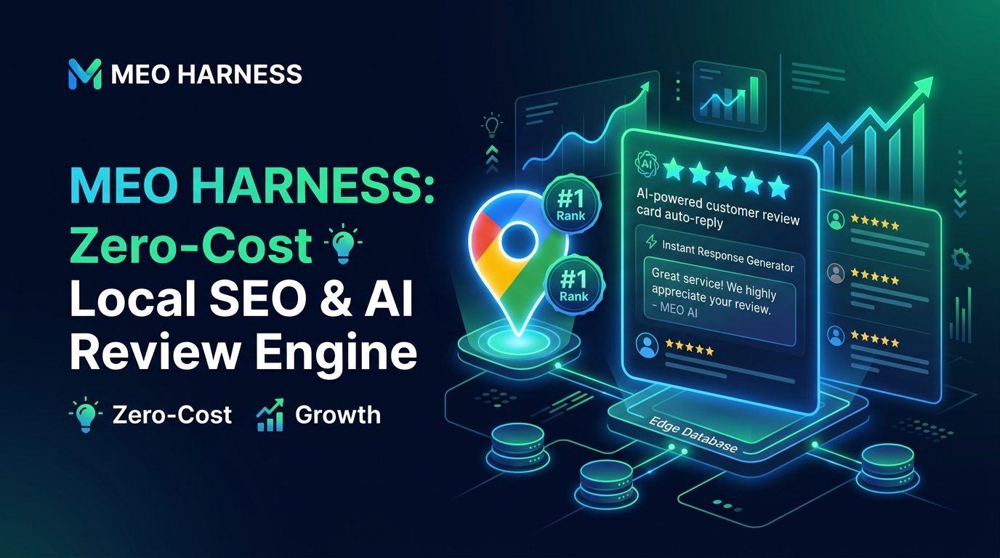

# MEO Harness 📍🤖
**Zero-Cost Google Business Profile AI Review Auto-Reply & Local Keyword Rank Tracker on Cloudflare Workers + D1 + MCP**



月額3万〜5万円のMEO運用代行や口コミ管理SaaS（MEOチェキ、口コミコム等）を、**Cloudflare Workers + D1 の完全無料枠（月額0円）**で代替するオープンソースのGoogleビジネスプロフィール（Googleマップ）自動運用エンジンです。

## ✨ 主な特徴
1. **MEO対策キーワードを自然に含めた「口コミAI自動返信」**: 高評価口コミには感謝と地域×業種キーワード（例：`表参道 髪質改善 ヘッドスパ`）を自然に織り交ぜた返信を生成し、低評価には誠実な改善返信を即座にドラフト。
2. **地域キーワード検索順位トラッカー**: Googleマップ上の重要キーワード順位の推移と競合1位店舗をD1で一元管理。
3. **AIエージェント（MCP）完全対応**: Claude Code や Cursor から直接口コミ分析・順位チェックが可能。

## 🚀 クイックスタート
```bash
git clone https://github.com/reina20xx/meo-harness.git
cd meo-harness
npm install
npm run dev
node test-e2e.js
```
## 📄 ライセンス
MIT License
